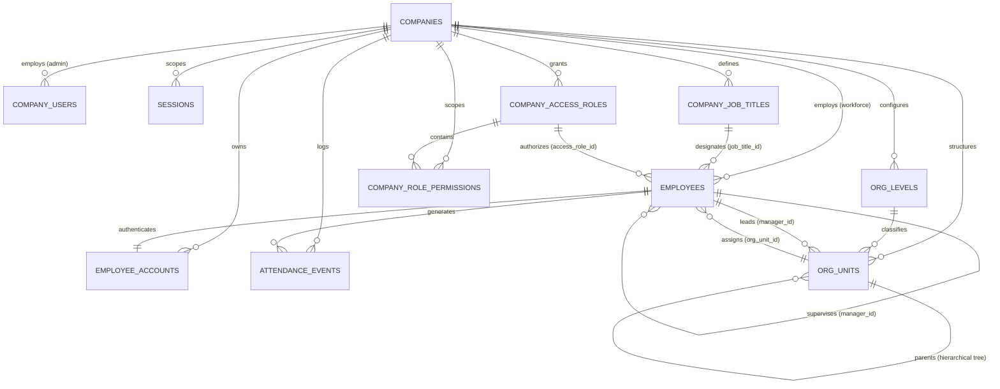

# SmartWorkforce — Database Architecture & Persistence Layer

This directory houses the persistent relational database tier for the **SmartWorkforce** platform.

Powered entirely by native Node.js (`node:sqlite` via `DatabaseSync`), the persistence layer requires **zero external NPM packages**, operating with high-speed Write-Ahead Logging (WAL) and strict foreign key integrity.

---

## 📁 Directory Architecture

```
database/
├── database.js          # Connection manager, CRUD query routines, and recursive CTEs
├── schema.sql           # Canonical SQLite DDL schema defining all 12 tables and 25 indexes
├── migrate.js           # Idempotent, transactional incremental schema migration engine
├── smartworkforce.db    # Production SQLite database file (WAL mode)
└── README.md            # This technical documentation
```

### Purpose of Every Database File

| File | Type | Purpose & Responsibility |
| :--- | :--- | :--- |
| **[database.js](file:///k:/final%20project/SmartWorkforce/database/database.js)** | JavaScript Data Access Layer | Opens and manages the `DatabaseSync` connection (`PRAGMA foreign_keys = ON`, WAL mode). Exposes high-level data access methods for employee lifecycle, attendance telemetry, multi-tenant authentication, and recursive CTE queries (`getReportingChain`, `getRecursiveSubordinates`). |
| **[schema.sql](file:///k:/final%20project/SmartWorkforce/database/schema.sql)** | Declarative SQL DDL | The single source of truth for the complete relational schema. Defines all 12 tables, columns, constraints (`CHECK`, `DEFAULT`, `UNIQUE`), cascading rules (`CASCADE`, `SET NULL`), and compound indexes. |
| **[migrate.js](file:///k:/final%20project/SmartWorkforce/database/migrate.js)** | Transactional Migration Engine | Executes incremental, idempotent schema migrations. Manages schema evolution (e.g., `v2_org_tree_roles`), safely alters existing tables, backfills legacy employee foreign keys, seeds baseline organizational tiers/roles, and validates zero foreign key violations post-run. |
| **[smartworkforce.db](file:///k:/final%20project/SmartWorkforce/database/smartworkforce.db)** | SQLite Database (Disk Storage) | The shared production SQLite database. Houses all active multi-tenant enterprises, administrators, employees, credentials, and telemetry events. |
| **[README.md](file:///k:/final%20project/SmartWorkforce/database/README.md)** | Technical Reference | Complete data dictionary, entity-relationship diagrams, migration mechanics, and testing safety rules. |

---

## 🏛️ Entity Relationship Diagram



---

## 🗄️ Complete Data Dictionary (12 Tables)

### 1. `companies` (Multi-Tenant Workspaces)
Represents isolated tenant organizations within the system.
- **Primary Key**: `id` (e.g., `COMP-DEFAULT-01`, `COMP-4EA5B49E710B`)
- **Columns**:
  - `id` (TEXT, PK): Unique company identifier.
  - `name` (TEXT, NOT NULL): Company legal/brand name.
  - `industry` (TEXT, NOT NULL): Industry sector (e.g., Manufacturing, Aerospace).
  - `email` (TEXT, NOT NULL, UNIQUE): Primary contact email.
  - `created_at` (TEXT, NOT NULL): ISO 8601 creation timestamp.
  - `updated_at` (TEXT, NOT NULL): ISO 8601 update timestamp.
- **Indexes**: `idx_companies_email` (UNIQUE).

### 2. `company_users` (Administrative Accounts)
Privileged users (`COMPANY_HEAD`, `COMPANY_ADMIN`) with full organizational authority.
- **Primary Key**: `id` (e.g., `USR-ADMIN-01`)
- **Foreign Keys**: `company_id` REFERENCES `companies(id)` ON DELETE CASCADE.
- **Columns**:
  - `id` (TEXT, PK): Unique user identifier.
  - `company_id` (TEXT, NOT NULL, FK): Tenant association.
  - `email` (TEXT, NOT NULL, UNIQUE): Login email.
  - `full_name` (TEXT, NOT NULL): Administrator name.
  - `password_hash` (TEXT, NOT NULL): Scrypt hash (64 bytes hex).
  - `password_salt` (TEXT, NOT NULL): 16-byte random salt hex.
  - `role` (TEXT, NOT NULL, CHECK: `'COMPANY_HEAD'`, `'COMPANY_ADMIN'`): Role type.
  - `created_at` (TEXT, NOT NULL): ISO 8601 timestamp.
  - `updated_at` (TEXT, NOT NULL): ISO 8601 timestamp.
- **Indexes**: `idx_company_users_company`, `idx_company_users_email`.

### 3. `employees` (Workforce & Smart Badges)
Operational employees with RFID badges, hierarchical placement, and reporting lines.
- **Primary Key**: `id` (e.g., `EMP-101`)
- **Foreign Keys**:
  - `company_id` REFERENCES `companies(id)`
  - `manager_id` REFERENCES `employees(id)` ON DELETE SET NULL
  - `org_unit_id` REFERENCES `org_units(id)` ON DELETE SET NULL
  - `job_title_id` REFERENCES `company_job_titles(id)` ON DELETE SET NULL
  - `access_role_id` REFERENCES `company_access_roles(id)` ON DELETE SET NULL
- **Columns**:
  - `id` (TEXT, PK): Unique employee ID.
  - `name` (TEXT, NOT NULL): Full legal name.
  - `department` (TEXT, NOT NULL): Legacy department name (preserved for backward compatibility).
  - `role` (TEXT, NOT NULL): Legacy role description (preserved for backward compatibility).
  - `uid` (TEXT, UNIQUE, NULLABLE): Contactless RFID card UID (e.g., `7E:A1:39:B2`). Nullable for badge-less staff.
  - `status` (TEXT, NOT NULL, DEFAULT `'OUTSIDE'`): Live presence status (`'INSIDE'` / `'OUTSIDE'`).
  - `last_seen` (TEXT, NOT NULL, DEFAULT `'Not detected today'`): Last checkpoint timestamp/label.
  - `avatar_bg` (TEXT, NOT NULL, DEFAULT `'#0284C7'`): Hex color for avatar display.
  - `created_at` (TEXT, NOT NULL): ISO 8601 creation timestamp.
  - `company_id` (TEXT, FK): Multi-tenant company ownership.
  - `email` (TEXT): Official company email.
  - `phone` (TEXT): Contact telephone number.
  - `is_archived` (INTEGER, NOT NULL, DEFAULT `0`): Soft-delete flag (0 = active, 1 = archived).
  - `archived_at` (TEXT): ISO 8601 timestamp of archival.
  - `manager_id` (TEXT, FK): Direct reporting supervisor.
  - `org_unit_id` (TEXT, FK): Primary organizational unit/department.
  - `job_title_id` (TEXT, FK): Dynamic HR job title.
  - `access_role_id` (TEXT, FK): Authorization role grant.
- **Indexes**: `idx_employees_company_id`, `idx_employees_uid`, `idx_employees_is_archived`, `idx_employees_company_email` (UNIQUE), `idx_employees_manager_id`, `idx_employees_org_unit_id`, `idx_employees_job_title_id`, `idx_employees_access_role_id`.

### 4. `employee_accounts` (Employee Authentication Credentials)
Stores credentials for self-service employee portal access.
- **Primary Key**: `id` (e.g., `ACC-73891048`)
- **Foreign Keys**:
  - `employee_id` REFERENCES `employees(id)` ON DELETE CASCADE
  - `company_id` REFERENCES `companies(id)` ON DELETE CASCADE
- **Columns**:
  - `id` (TEXT, PK): Unique account ID.
  - `employee_id` (TEXT, NOT NULL, UNIQUE, FK): Linked employee.
  - `company_id` (TEXT, NOT NULL, FK): Tenant company.
  - `password_hash` (TEXT, NOT NULL): Scrypt password hash.
  - `password_salt` (TEXT, NOT NULL): 16-byte random salt.
  - `must_change_password` (INTEGER, NOT NULL, DEFAULT `1`): Enforces password reset on initial login.
  - `account_status` (TEXT, NOT NULL, DEFAULT `'ACTIVE'`, CHECK: `'ACTIVE'`, `'SUSPENDED'`, `'PENDING'`): Account lifecycle state.
  - `password_updated_at` (TEXT): Timestamp of last password modification.
  - `created_at` (TEXT, NOT NULL): ISO 8601 timestamp.
  - `updated_at` (TEXT, NOT NULL): ISO 8601 timestamp.
- **Indexes**: `idx_employee_accounts_emp` (UNIQUE), `idx_employee_accounts_company`.

### 5. `sessions` (Server-Side Session State & CSRF)
Tracks active logins for both company administrators and employees.
- **Primary Key**: `id` (e.g., `SES-SHA256-HASH`)
- **Foreign Keys**: `company_id` REFERENCES `companies(id)` ON DELETE CASCADE.
- **Columns**:
  - `id` (TEXT, PK): Cryptographically random session identifier.
  - `account_id` (TEXT, NOT NULL): References `company_users.id` or `employee_accounts.id`.
  - `user_type` (TEXT, NOT NULL, CHECK: `'COMPANY_HEAD'`, `'COMPANY_ADMIN'`, `'EMPLOYEE'`): Identity type.
  - `company_id` (TEXT, NOT NULL, FK): Associated enterprise tenant.
  - `csrf_token` (TEXT, NOT NULL): 32-byte cryptographic token validated on state-mutating requests.
  - `ip_address` (TEXT): Client network IP address.
  - `user_agent` (TEXT): Client browser user agent string.
  - `created_at` (TEXT, NOT NULL): ISO 8601 timestamp.
  - `expires_at` (TEXT, NOT NULL): Expiry threshold (typically 24 hours).
- **Indexes**: `idx_sessions_account` (`account_id`, `user_type`), `idx_sessions_company`, `idx_sessions_expires`.

### 6. `attendance_events` (Contactless Checkpoint Telemetry)
Immutable event ledger recording badge tap transactions from physical or simulated readers.
- **Primary Key**: `id` (e.g., `LOG-1001`)
- **Foreign Keys**:
  - `emp_id` REFERENCES `employees(id)` ON DELETE CASCADE
  - `company_id` REFERENCES `companies(id)`
- **Columns**:
  - `id` (TEXT, PK): Transaction log ID.
  - `timestamp` (TEXT, NOT NULL): Event presentation timestamp (`YYYY-MM-DD HH:MM:SS`).
  - `emp_id` (TEXT, NOT NULL, FK): Scanned employee ID.
  - `emp_name` (TEXT, NOT NULL): Employee name at time of scan.
  - `department` (TEXT, NOT NULL): Employee department at time of scan.
  - `event_type` (TEXT, NOT NULL, CHECK: `'ENTRY'`, `'EXIT'`): Directional movement.
  - `gate` (TEXT, NOT NULL): Physical turnstile or portal (e.g., `Gate 01 - Main Turnstile`).
  - `status` (TEXT, NOT NULL, DEFAULT `'VERIFIED'`): Processing status.
  - `created_at` (TEXT, NOT NULL): ISO 8601 insertion timestamp.
  - `company_id` (TEXT, FK): Tenant company association.
- **Indexes**: `idx_events_emp_id`, `idx_events_timestamp`, `idx_attendance_events_company_id`.

### 7. `org_levels` (Hierarchical Tier Definitions)
Company-specific tier rankings (e.g., Rank 1: Executive, Rank 2: Department Head, Rank 3: Team Lead, Rank 4: Staff).
- **Primary Key**: `id` (e.g., `LVL-98401928`)
- **Foreign Keys**: `company_id` REFERENCES `companies(id)` ON DELETE CASCADE.
- **Columns**:
  - `id` (TEXT, PK): Unique tier ID.
  - `company_id` (TEXT, NOT NULL, FK): Tenant association.
  - `name` (TEXT, NOT NULL): Tier title.
  - `rank` (INTEGER, NOT NULL): Numerical seniority rank (1 = highest).
  - `created_at` (TEXT, NOT NULL): ISO 8601 timestamp.
  - `updated_at` (TEXT, NOT NULL): ISO 8601 timestamp.
- **Constraints**: UNIQUE(`company_id`, `rank`), UNIQUE(`company_id`, `name`).
- **Indexes**: `idx_org_levels_company`, `idx_org_levels_rank`.

### 8. `org_units` (Organizational Structure Tree)
Hierarchical tree of business units (Divisions, Departments, Sub-teams, Plants).
- **Primary Key**: `id` (e.g., `UNIT-38291048`)
- **Foreign Keys**:
  - `company_id` REFERENCES `companies(id)` ON DELETE CASCADE
  - `parent_unit_id` REFERENCES `org_units(id)` ON DELETE SET NULL (self-referencing tree)
  - `level_id` REFERENCES `org_levels(id)` ON DELETE SET NULL
  - `manager_id` REFERENCES `employees(id)` ON DELETE SET NULL
- **Columns**:
  - `id` (TEXT, PK): Unique unit ID.
  - `company_id` (TEXT, NOT NULL, FK): Tenant association.
  - `name` (TEXT, NOT NULL): Department or unit name.
  - `unit_type` (TEXT, NOT NULL, DEFAULT `'DEPARTMENT'`): Unit category.
  - `parent_unit_id` (TEXT, FK): Parent unit ID for tree nesting.
  - `level_id` (TEXT, FK): Assigned organizational level tier.
  - `manager_id` (TEXT, FK): Designated unit manager/head.
  - `created_at` (TEXT, NOT NULL): ISO 8601 timestamp.
  - `updated_at` (TEXT, NOT NULL): ISO 8601 timestamp.
- **Indexes**: `idx_org_units_company`, `idx_org_units_parent`, `idx_org_units_level`, `idx_org_units_manager`, `idx_org_units_root_name` (UNIQUE root), `idx_org_units_child_name` (UNIQUE siblings).

### 9. `company_job_titles` (HR Designations)
Dynamic job titles decoupled from system permissions (e.g., "Senior Firmware Engineer", "QA Specialist").
- **Primary Key**: `id` (e.g., `JOB-10293847`)
- **Foreign Keys**: `company_id` REFERENCES `companies(id)` ON DELETE CASCADE.
- **Columns**:
  - `id` (TEXT, PK): Unique title ID.
  - `company_id` (TEXT, NOT NULL, FK): Tenant association.
  - `title` (TEXT, NOT NULL): Job title text.
  - `description` (TEXT): Role expectations or notes.
  - `is_active` (INTEGER, NOT NULL, DEFAULT `1`): Active status (1 = active, 0 = inactive).
  - `created_at` (TEXT, NOT NULL): ISO 8601 timestamp.
  - `updated_at` (TEXT, NOT NULL): ISO 8601 timestamp.
- **Constraints**: UNIQUE(`company_id`, `title`).
- **Indexes**: `idx_company_job_titles_company`, `idx_company_job_titles_active`.

### 10. `company_access_roles` (Authorization Roles)
Configurable security roles granting system privileges.
- **Primary Key**: `id` (e.g., `ROLE-49201948`)
- **Foreign Keys**: `company_id` REFERENCES `companies(id)` ON DELETE CASCADE.
- **Columns**:
  - `id` (TEXT, PK): Unique role ID.
  - `company_id` (TEXT, NOT NULL, FK): Tenant association.
  - `name` (TEXT, NOT NULL): Role name (e.g., `'Administrator'`, `'Department Head'`, `'Team Lead'`, `'Employee'`).
  - `description` (TEXT): Role description and purpose.
  - `is_system_role` (INTEGER, NOT NULL, DEFAULT `0`): Protected status (1 = system protected from deletion, 0 = custom).
  - `created_at` (TEXT, NOT NULL): ISO 8601 timestamp.
  - `updated_at` (TEXT, NOT NULL): ISO 8601 timestamp.
- **Constraints**: UNIQUE(`company_id`, `name`).
- **Indexes**: `idx_company_access_roles_company`.

### 11. `company_role_permissions` (Granular Permission Scopes)
Defines exact permissions and scopes assigned to each access role.
- **Primary Key**: `id` (e.g., `PERM-58291048`)
- **Foreign Keys**:
  - `role_id` REFERENCES `company_access_roles(id)` ON DELETE CASCADE
  - `company_id` REFERENCES `companies(id)` ON DELETE CASCADE
- **Columns**:
  - `id` (TEXT, PK): Unique permission grant ID.
  - `role_id` (TEXT, NOT NULL, FK): Target role.
  - `company_id` (TEXT, NOT NULL, FK): Tenant company.
  - `permission_key` (TEXT, NOT NULL): Action identifier (`employees:view`, `employees:manage`, `attendance:view`, `attendance:manage`, `analytics:view`, `org:view`, `org:manage`, `roles:manage`).
  - `scope` (TEXT, NOT NULL, DEFAULT `'COMPANY'`, CHECK: `'SELF'`, `'DIRECT_REPORTS'`, `'DESCENDANTS'`, `'DEPARTMENT'`, `'COMPANY'`): Visibility boundaries.
  - `created_at` (TEXT, NOT NULL): ISO 8601 timestamp.
- **Constraints**: UNIQUE(`role_id`, `permission_key`).
- **Indexes**: `idx_role_permissions_role`, `idx_role_permissions_company`, `idx_role_permissions_key`.

### 12. `schema_migrations` (Migration Ledger)
Audit log tracking applied schema migration versions.
- **Primary Key**: `version` (e.g., `'v2_org_tree_roles'`)
- **Columns**:
  - `version` (TEXT, PK): Migration name.
  - `applied_at` (TEXT, NOT NULL): ISO 8601 timestamp of execution.

---

## 🔄 Inter-Entity Relationships & Business Logic

1. **Multi-Tenancy Isolation**:
   - Every table except `schema_migrations` carries a `company_id` foreign key.
   - All REST queries and mutations strictly filter by `WHERE company_id = ?`, preventing data leakage across companies.
2. **Decoupled HR Job Titles vs. Access Roles**:
   - An employee has both a `job_title_id` (e.g., "Senior Systems Architect") and an `access_role_id` (e.g., "Team Lead").
   - This decoupling allows organizations to promote employees or adjust titles without altering their security authorization profiles.
3. **Recursive Organizational Hierarchy**:
   - `org_units.parent_unit_id` forms a self-referencing tree structure.
   - Circular unit relationships ($A \to B \to A$) are prevented by recursive CTE path validation prior to insertion.
4. **Recursive Reporting Chain & Subordinates**:
   - `employees.manager_id` establishes an upward reporting line.
   - Upward breadcrumbs and downward descendant lists are computed via recursive Common Table Expressions (CTEs):
     - `getReportingChain`: Ascends from an employee up to the highest executive.
     - `getRecursiveSubordinates`: Descends to identify all indirect reports across departments.
5. **Polymorphic Server-Side Sessions**:
   - The `sessions` table tracks active logins for both company administrators (`company_users`) and workforce employees (`employee_accounts`) using the `user_type` column (`'COMPANY_HEAD'`, `'COMPANY_ADMIN'`, `'EMPLOYEE'`).
   - Every session includes a unique `csrf_token` required on all state-mutating requests (`POST`, `PUT`, `DELETE`).

---

## 🛠️ Schema Creation vs. Migration Evolution

| Table Name | Created by `schema.sql` | Created / Modified by `migrate.js` | Notes |
| :--- | :---: | :---: | :--- |
| `companies` | Yes | Yes | Created during migration step A. Baseline `COMP-DEFAULT-01` seeded if empty. |
| `company_users` | Yes | Yes | Created during migration step B. Default admin account seeded. |
| `employees` | Yes | Yes | Base table created in `database.js`; `migrate.js` adds `company_id`, `email`, `phone`, `is_archived`, `archived_at`, `manager_id`, `org_unit_id`, `job_title_id`, `access_role_id`. |
| `employee_accounts` | Yes | Yes | Created during migration step C. Password hashes seeded for baseline workforce. |
| `sessions` | Yes | Yes | Created during migration step D. |
| `attendance_events` | Yes | Yes | Base table created in `database.js`; `migrate.js` adds `company_id` and ensures foreign keys. |
| `org_levels` | Yes | Yes | Introduced in migration `v2_org_tree_roles`. Baseline tiers (Executive, Dept Head, Lead, Staff) seeded. |
| `org_units` | Yes | Yes | Introduced in migration `v2_org_tree_roles`. Legacy departments backfilled into units. |
| `company_job_titles` | Yes | Yes | Introduced in migration `v2_org_tree_roles`. Legacy roles backfilled into titles. |
| `company_access_roles`| Yes | Yes | Introduced in migration `v2_org_tree_roles`. 4 baseline system roles seeded. |
| `company_role_permissions`| Yes | Yes | Introduced in migration `v2_org_tree_roles`. Standard permissions matrix seeded. |
| `schema_migrations` | Yes | Yes | Ledger table tracking applied migrations. |

---

## 🛡️ Database Safety Rules & Testing Procedures

1. **Production Database Protection**:
   - **Never run `npm run reset-db` on production**. This command truncates and re-seeds data.
   - Never delete or overwrite [database/smartworkforce.db](file:///k:/final%20project/SmartWorkforce/database/smartworkforce.db).
2. **Automated Test Isolation**:
   - All automated test suites (`npm test`, `npm run test:unit`, `npm run test:integration`) set `process.env.DB_PATH` to a temporary isolated file in `tests/` (e.g., `tests/isolated_phase3_api.db`).
   - Modules are loaded after `DB_PATH` is initialized, guaranteeing that zero test operations affect `smartworkforce.db`.
3. **Migration Idempotency**:
   - `runMigration()` can be run repeatedly without altering existing data or creating duplicate records.
   - Pre-flight and post-flight record count assertions ensure that zero employee or event rows are lost during migrations.
4. **Foreign Key Integrity Verification**:
   - Whenever migrations run, `PRAGMA foreign_key_check;` is executed inside the migration transaction to guarantee zero orphaned records.
